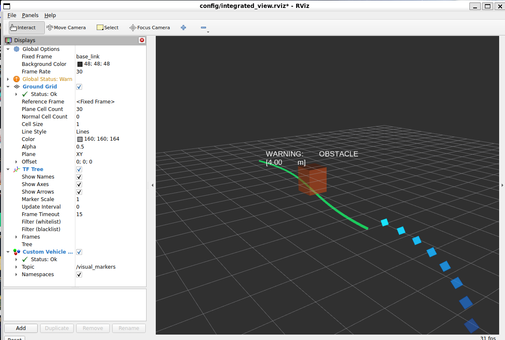
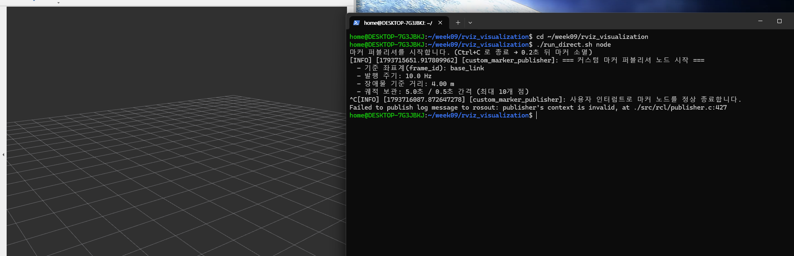
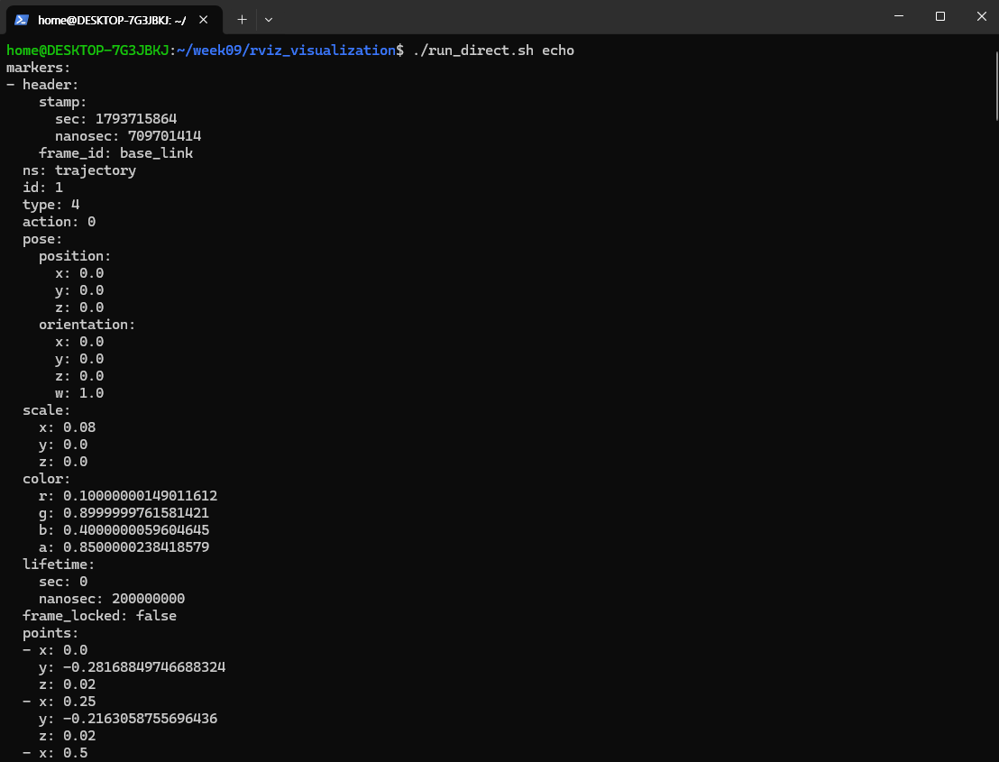
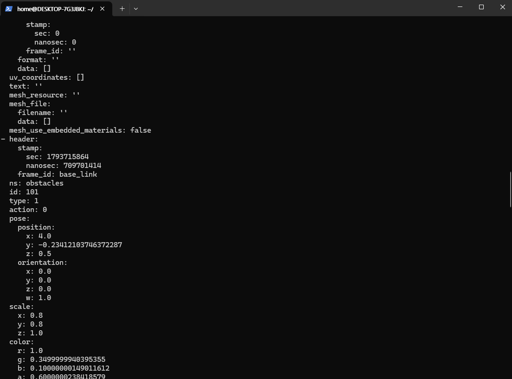
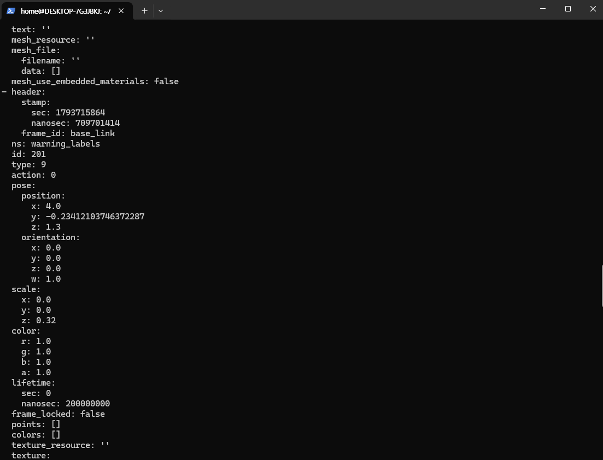
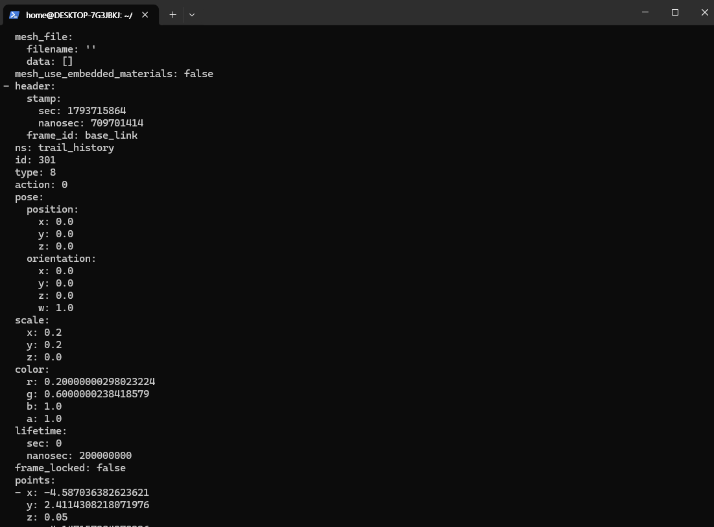
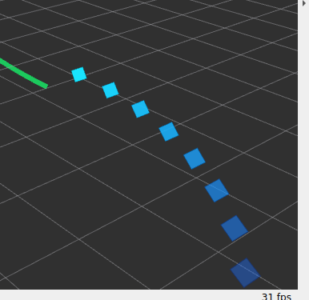

# 9주차 — RViz2 심화 시각화와 커스텀 마커 파이프라인

오토모티브SW프로그래밍 9주차 실습 · 컴퓨터공학 / 21114020 / 조민서

`visualization_msgs/MarkerArray` 하나로 **주행 경로선 · 장애물 박스 · 빌보드 텍스트 ·
과거 주행 궤적** 네 종류의 마커를 10Hz로 발행하고, RViz2에서 3D로 띄우는 패키지입니다.

실행 환경: WSL2 Ubuntu 26.04 + ROS 2 Lyrical Luth

---

## 1. 결과물 요약

| 미션 | 내용 | 구현 위치 | 결과 |
|---|---|---|---|
| 1 | S자 경로선 · 장애물 큐브 · 빌보드 텍스트 동시 렌더링 | 마커 1~3 | 완료 |
| 2 | 노드 종료 0.2초 뒤 마커 자동 소멸 (`lifetime`) | 전 마커 공통 | 완료 |
| 3 | `/visual_markers` 패킷 구조 확인 | `ros2 topic echo` | 완료 |
| 4 (도전) | 과거 5초 궤적을 0.5초 간격 알파 그라데이션 POINTS로 시각화 | `update_virtual_odometry()`, `build_trail_marker()` | 완료 |

---

## 2. 디렉터리 구조

```
rviz_visualization/
├── package.xml
├── setup.py
├── setup.cfg
├── resource/rviz_visualization
├── rviz_visualization/
│   ├── __init__.py
│   └── custom_marker_publisher.py   # 마커 발행 노드 (4종)
├── config/
│   └── integrated_view.rviz         # RViz2 설정 (Fixed Frame: base_link)
├── launch/
│   └── rviz_advanced.launch.py      # 노드 + RViz2 동시 기동
├── run_direct.sh                    # 빌드 없이 실행하는 보조 스크립트
└── screenshots/                     # 실행 화면 캡처
```

---

## 3. 실행 방법

먼저 ROS 2 환경을 source 합니다.

```bash
source /opt/ros/$ROS_DISTRO/setup.bash
```

### WSL2에서 RViz2를 띄우기 전에

WSLg 환경에서는 Qt가 Wayland로 창을 만드는데 RViz2의 렌더링 백엔드인 OGRE는
그 창에 GLX(X11)를 붙이려 하기 때문에 창 핸들이 맞지 않아 실행이 실패합니다.

```
rviz::RenderSystem: error creating render window:
  RenderingAPIException: Invalid parentWindowHandle (wrong server or screen)
Unable to create the rendering window after 100 tries
```

Qt를 X11 백엔드로 강제하면 해결됩니다.

```bash
export QT_QPA_PLATFORM=xcb
echo 'export QT_QPA_PLATFORM=xcb' >> ~/.bashrc
```

> 로그에 `OpenGl version: 4.5` 가 찍히므로 GL 자체는 정상이며,
> `LIBGL_ALWAYS_SOFTWARE=1` 같은 소프트웨어 렌더링 전환은 이 증상에 효과가 없습니다.
> 원인이 GL이 아니라 **창 시스템 불일치**이기 때문입니다.

### 방법 A — 패키지 빌드 후 런치 (권장)

```bash
mkdir -p ~/ros2_ws/src
cp -r rviz_visualization ~/ros2_ws/src/

cd ~/ros2_ws
colcon build --symlink-install --packages-select rviz_visualization
source install/setup.bash

ros2 launch rviz_visualization rviz_advanced.launch.py
```

런치 인자로 파라미터를 바꿀 수 있습니다.

```bash
ros2 launch rviz_visualization rviz_advanced.launch.py \
  obstacle_distance:=6.0 publish_rate:=20.0
```

### 방법 B — 빌드 없이 바로 실행

터미널 2개를 씁니다.

```bash
# 터미널 1
./run_direct.sh node

# 터미널 2
./run_direct.sh rviz
```

---

## 4. 미션별 검증 결과

### 미션 1 — 3종 마커 동시 렌더링



화면에서 확인한 내용입니다.

- 차량 전방으로 뻗는 **녹색 S자 경로선**(LINE_STRIP, 선 두께 0.08m)
- 전방 4m 지점의 **반투명 주황-빨강 큐브**(0.8 × 0.8 × 1.0m), 내부 격자가 비쳐 보임
- 큐브 위 0.8m 지점의 **흰색 경고 텍스트** `WARNING: OBSTACLE [4.00 m]`,
  거리 값이 실시간 갱신됨
- 시점을 비스듬히 기울여도 텍스트가 **정면을 응시**(빌보드 효과)
- 차량 뒤로 이어지는 **파란 궤적 점**(도전 미션, 아래 미션 4에서 상세)
- 우하단 **31 fps** 표시 — 깜빡임 없이 연속 렌더링

좌측 Displays 패널에서도 설정이 의도대로 걸려 있음이 보입니다.

| 항목 | 값 |
|---|---|
| Fixed Frame | `base_link` |
| Background Color | 48; 48; 48 (다크 그레이 — 마커 대비 극대화) |
| Custom Vehicle Markers → Topic | `/visual_markers` |
| Custom Vehicle Markers → Status | **Ok** |

> `Global Status: Warn` 은 TF Tree 디스플레이가 켜져 있는데 이번 주 실습에는 TF
> 브로드캐스터가 없어서 나는 경고입니다. 마커는 `base_link` 를 Fixed Frame으로
> 직접 쓰므로 변환이 필요 없고, Custom Vehicle Markers 의 Status가 Ok인 것으로
> 마커 파이프라인 자체는 정상임이 확인됩니다.

### 미션 2 — lifetime 잔상 제거



마커 노드 터미널에서 `Ctrl+C`를 누른 직후의 화면입니다.

```
^C[INFO] [custom_marker_publisher]: 사용자 인터럽트로 마커 노드를 정상 종료합니다.
```

**0.2초 뒤 RViz2 화면에 격자(Grid)만 남고 마커 4종이 모두 사라졌습니다.**
궤적 포인트까지 함께 소멸했으므로, 도전 미션으로 추가한 마커도 동일한 수명 정책을
따르는 것이 확인됩니다.

동작 원리는 다음과 같습니다. 모든 마커에 `lifetime = 0.2초`를 넣어 두었고 발행
주기는 10Hz(0.1초)입니다. 정상 동작 중에는 수명이 만료되기 전에 새 마커가 도착해
타이머가 계속 리셋되므로 깜빡임 없이 유지됩니다. 노드가 죽어 재수신이 끊기면
0.2초 뒤 RViz2가 해당 마커를 그래픽 메모리에서 스스로 제거합니다.

`lifetime`을 기본값 0으로 두면 **무한 수명**이 되어, 노드가 비정상 종료돼도 과거
장애물 박스가 화면에 영구히 박제됩니다. 모니터링하는 사람이 이미 사라진 장애물을
실재하는 것으로 오판하게 되므로, 발행 주기의 2배 정도를 수명으로 잡는 것이
안전합니다.

> 종료 시 출력되는 `Failed to publish log message to rosout: publisher's context is
> invalid` 는 컨텍스트가 내려간 뒤 로그를 한 번 더 내보내려 해서 나는 메시지로,
> 노드 종료 자체에는 영향이 없습니다.

### 미션 3 — MarkerArray 패킷 구조

```bash
ros2 topic echo /visual_markers --once
```

단일 패킷 안에 마커 4개가 순서대로 들어 있는 것을 확인했습니다.

| 순서 | ns | id | type | 캡처 |
|---|---|---|---|---|
| 0 | `trajectory` | 1 | 4 (LINE_STRIP) | [그림](screenshots/03_echo_1_trajectory.png) |
| 1 | `obstacles` | 101 | 1 (CUBE) | [그림](screenshots/03_echo_2_obstacle.png) |
| 2 | `warning_labels` | 201 | 9 (TEXT_VIEW_FACING) | [그림](screenshots/03_echo_3_text.png) |
| 3 | `trail_history` | 301 | 8 (POINTS) | [그림](screenshots/03_echo_4_trail.png) |









#### 원자적 전송의 직접 증거

네 캡처의 `header.stamp` 가 **모두 동일합니다.**

```
sec: 1793715864
nanosec: 709701414
```

마커를 개별 토픽으로 4번 발행했다면 각 메시지가 서로 다른 시각에 만들어져
타임스탬프가 어긋나고, RViz2가 이들을 서로 다른 프레임에 나눠 그릴 수 있습니다.
`MarkerArray` 로 묶으면 단 한 번의 `publish()` 로 네 마커가 같은 타임스탬프를 달고
나가므로 **1프레임의 오차도 없이 동시에 렌더링**됩니다.

#### 캡처에서 읽을 수 있는 값

| 항목 | 값 | 의미 |
|---|---|---|
| 경로선 `scale.x` | 0.08 | 선 두께 8cm (LINE_STRIP은 scale.x만 사용) |
| 경로선 `color` | (0.10, 0.90, 0.40, 0.85) | 에메랄드 그린, 알파 85% |
| 장애물 `pose` | (4.00, −0.234, 0.50) | 전방 4m, 좌우 횡단 중, 박스 중심 높이 0.5m |
| 장애물 `scale` | (0.8, 0.8, 1.0) | 가로·세로 0.8m, 높이 1.0m |
| 텍스트 `pose.z` | 1.30 | 장애물 중심 0.5 + 0.8 = 1.3m |
| 텍스트 `scale.z` | 0.32 | 폰트 높이 32cm (TEXT는 scale.z만 사용) |
| 궤적 `scale` | (0.2, 0.2) | 점 하나의 폭·높이 (POINTS는 x, y만 사용) |
| 궤적 첫 점 | (−4.587, 2.411, 0.05) | x가 음수 → 차량 **뒤쪽**에 위치 |
| 전 마커 `lifetime` | `sec: 0, nanosec: 200000000` | 0.2초 |

궤적 첫 점의 x가 −4.587m라는 것은 가장 오래된 점이 차량 뒤 약 4.6m 지점에 있다는
뜻입니다. 속도 1.2 m/s × 5초 ≈ 6m 를 호를 그리며 지나왔으므로 직선거리로는
그보다 짧은 값이 나오는 것이 맞습니다.

### 미션 4 (도전) — 과거 5초 궤적 그라데이션



미션 1 화면에서 궤적 부분을 확대한 것입니다. 차량 뒤로 점들이 꼬리처럼 이어지고,
오래된 점일수록 흐려지면서 **밝은 시안에서 짙은 파랑으로** 식어 가는 것이 보입니다.
차량이 선회하고 있으므로 궤적도 호를 그립니다.

점의 개수가 10개인 것은 `5.0초 ÷ 0.5초 = 10` 이라는 샘플링 설계 그대로입니다.
가장 가까운 점은 방금 지나온 위치라 거의 불투명하고, 가장 먼 점은 5초 전 위치라
배경에 묻힐 만큼 투명합니다. 이 농도 차이가 그대로 **시간 축**이 됩니다.

---

## 5. 도전 미션 구현 설명

### 왜 그냥 좌표를 쌓으면 안 되는가

모든 마커는 `base_link`, 즉 **차량에 붙어 함께 움직이는 좌표계**로 발행됩니다.
과거 위치를 base_link 좌표 그대로 저장해 두면 그 점들도 차량을 따라다니므로
궤적이 되지 않고 제자리에 뭉쳐 있게 됩니다.

그래서 월드 좌표를 따로 유지합니다.

**① 가상 오도메트리 적분** — 실제 차량이라면 `/odom` 구독이나 TF2 조회로 얻을
값을, 여기서는 등속·등각속도 모델로 직접 적분합니다.

```
θ ← θ + ω·Δt
x ← x + v·cos(θ)·Δt
y ← y + v·sin(θ)·Δt
```

**② 0.5초 간격 샘플링** — 10Hz로 적분하되 궤적 점은 0.5초마다 하나씩만 적립합니다.
5초 ÷ 0.5초 = **최대 10개**가 유지되고, 보관 시간을 넘긴 점은 `deque` 앞에서
제거합니다.

**③ 현재 차량 기준으로 역변환** — 발행 시점마다 저장해 둔 월드 좌표를 현재 차량
자세 기준으로 되돌립니다. 회전행렬의 전치를 곱하는 2차원 동차 변환입니다.

```
[ x_local ]   [  cosθ   sinθ ] [ wx − x ]
[ y_local ] = [ −sinθ   cosθ ] [ wy − y ]
```

이렇게 하면 점들이 차량 뒤쪽(`x_local < 0`)으로 흘러가며 선회 궤적을 그립니다.
캡처의 `x: -4.587` 이 이 변환이 동작하고 있다는 증거입니다.

**④ 점별 알파 그라데이션** — `Marker.POINTS` 는 `points[]` 와 `colors[]` 를 1:1로
대응시킬 수 있어 점마다 다른 투명도를 줄 수 있습니다. 경과 시간을 0~1로 정규화해
알파를 선형 감쇄시킵니다.

```
freshness = 1 − min(age / 5.0, 1.0)
alpha     = 0.10 + 0.85 × freshness
```

가장 최근 점이 `a ≈ 0.95`, 5초 전 점이 `a ≈ 0.10` 이 됩니다. 색상도 밝은 시안에서
짙은 파랑으로 함께 식혀, 투명도만으로 구분하기 어려운 환경에서도 시간 순서가
읽히게 했습니다.

### 마커를 10개로 쪼개지 않은 이유

점 10개를 각각 SPHERE 마커로 만들면 마커가 10개로 늘어나 `(ns, id)` 관리가
복잡해지고 렌더링 드로우 콜도 10배가 됩니다. **POINTS 한 개**로 처리하면 드로우
콜은 1회이고 수명 관리도 마커 하나만 신경 쓰면 됩니다. 같은 이유로 궤적 마커에도
동일한 `lifetime = 0.2초` 를 적용해 노드가 죽으면 함께 사라지게 했습니다.
미션 2 캡처에서 궤적도 같이 사라진 것이 그 결과입니다.

---

## 6. 파라미터

| 이름 | 기본값 | 설명 |
|---|---|---|
| `frame_id` | `base_link` | 마커 기준 좌표계 |
| `publish_rate` | `10.0` | 발행 주기 (Hz) |
| `obstacle_distance` | `4.0` | 전방 장애물 거리 (m) |
| `trail_duration` | `5.0` | 궤적 보관 시간 (초) |
| `trail_interval` | `0.5` | 궤적 샘플링 간격 (초) |
| `vehicle_speed` | `1.2` | 가상 차량 전진 속도 (m/s) |
| `vehicle_yaw_rate` | `0.22` | 가상 차량 요 각속도 (rad/s) |

```bash
ros2 param list /custom_marker_publisher
ros2 param get /custom_marker_publisher trail_duration
```

---

## 7. 구현 중 만난 문제와 해결

### 한글 텍스트 마커가 빈칸으로 렌더링됨

`TEXT_VIEW_FACING` 마커에 한글을 넣었더니 화면에 `[  ]  :  4.08  m` 처럼 글자가
빠진 채로 그려졌습니다. RViz2의 렌더링 백엔드인 **OGRE의 기본 폰트에 한글 글리프가
포함되어 있지 않기** 때문입니다. 숫자와 괄호 같은 ASCII 문자만 살아남았습니다.

강의자료 7단계의 판정 기준도 영문 표기(`WARNING: OBSTACLE [3.0m]`)이므로 텍스트를
ASCII로 바꿔 해결했습니다. 한글을 꼭 써야 한다면 OGRE에 한글 폰트를 리소스로
등록해야 하는데, 과제 범위를 넘어서므로 영문 표기를 택했습니다.

```python
text_marker.text = f'WARNING: OBSTACLE\n[{dist_to_obstacle:.2f} m]'
```

### WSLg에서 RViz2 창 생성 실패

3장에 정리한 `QT_QPA_PLATFORM=xcb` 문제입니다. 로그에 OpenGL 4.5가 정상으로 찍히는데도
창 생성이 100회 실패하는 것이 단서였습니다. GL 문제라면 버전 정보 자체가 안 나오므로,
원인이 렌더링이 아니라 **창 시스템(Wayland ↔ GLX) 불일치**라고 판단했습니다.

---

## 8. 자주 막히는 지점

| 증상 | 원인 | 해결 |
|---|---|---|
| RViz2 창이 아예 안 뜸 (WSL2) | Qt Wayland ↔ OGRE GLX 불일치 | `export QT_QPA_PLATFORM=xcb` |
| 텍스트가 빈칸으로 보임 | OGRE 기본 폰트에 한글 없음 | 텍스트를 ASCII로 작성 |
| 마커가 하나도 안 보임 | Fixed Frame 불일치 | Global Options → `base_link` 확인 |
| 토픽은 살아 있는데 안 보임 | `color.a = 0.0` | 알파 값부터 확인 |
| 마커 하나가 사라짐 | 같은 `ns` 에 중복 `id` | 네임스페이스를 나누거나 id 변경 |
| 궤적 점이 제자리에 뭉침 | 월드 좌표 역변환 누락 | `world_to_base_link()` 적용 확인 |
| 화면이 깜빡임 | `lifetime` < 발행 주기 | 수명을 발행 주기의 2배 이상으로 |
| 노드 종료 후 마커가 남음 | `lifetime = 0` (무한) | 0이 아닌 값 지정 |

---

## 9. AI 사용 관련 내용

Claude를 사용해 다음을 수행했습니다.

- `base_link` 기준 좌표계에서 과거 궤적을 표현하려면 월드 좌표를 따로 유지해야
  한다는 점과, 2차원 역변환 수식의 유도 과정 정리
- `Marker.POINTS` 의 `colors[]` 배열로 점별 알파를 줄 수 있다는 점 확인
- 패키지 구성에서 런치 파일의 상대경로 탐색이 깨지지 않도록 `launch/` 와 `config/` 를
  share 아래 같은 구조로 설치해야 한다는 점 검토
- WSLg 창 생성 실패 로그의 원인 분석 방향 (GL 버전이 정상 출력되는 점에 주목)

### 직접 검증한 내용

궤적 로직을 ROS 없이 따로 돌려 20초 구동 후 상태를 확인했습니다. 보관되는 점이
정확히 10개인지, `x_local` 이 전부 음수(차량 뒤쪽)인지, 알파가 0.12에서 0.90까지
단조 증가하는지를 수치로 확인했습니다. 실행 후에는 `ros2 topic echo` 출력의
`x: -4.587` 과 화면상의 점 개수가 사전 계산과 일치하는지 대조했습니다.

또한 네 마커의 `header.stamp` 가 모두 같은지를 캡처에서 직접 확인해,
`MarkerArray` 의 원자적 전송이 실제로 일어나는지를 검증했습니다.

---

## 10. 본인 보강 내용

기본 요구사항 외에 다음을 추가했습니다.

1. **도전 미션 구현** — 가상 오도메트리 적분과 월드→base_link 역변환으로 과거 5초
   궤적을 구현했습니다. 단순히 점을 쌓는 방식으로는 base_link에서 궤적이 성립하지
   않는다는 점을 짚고 해결했습니다.
2. **POINTS 단일 마커 설계** — 점 10개를 마커 10개로 만들지 않고 `colors[]` 를 쓴
   단일 마커로 처리해 드로우 콜과 수명 관리를 각각 1회로 줄였습니다.
3. **궤적 마커에도 동일 lifetime 적용** — 도전 미션으로 추가한 마커가 미션 2의 잔상
   제거 실증에서 예외가 되지 않도록 했습니다.
4. **한글 렌더링 문제 발견 및 해결** — 텍스트 마커가 빈칸으로 나오는 원인을 OGRE
   폰트 문제로 특정하고 ASCII 표기로 전환했습니다.
5. **원자적 전송 직접 검증** — 네 마커의 타임스탬프가 동일함을 캡처로 확인해,
   이론으로만 배운 `MarkerArray` 의 배치 전송 효과를 실측으로 뒷받침했습니다.
6. **파라미터화** — 궤적 보관 시간·샘플링 간격·가상 차량 속도를 ROS 파라미터로
   노출해 재빌드 없이 조정할 수 있게 했습니다.
7. **적분 주기와 샘플링 주기 분리** — `publish_rate` 를 바꿔도 "0.5초 간격"이라는
   요구사항이 깨지지 않도록 경과 시간 기준으로 샘플링합니다.
8. **`pose.orientation.w = 1.0` 명시** — 지정하지 않으면 쿼터니언이 (0,0,0,0)인
   비정규 상태가 되어 RViz2가 경고를 출력합니다. LINE_STRIP과 POINTS에도 넣어
   경고 없이 동작하게 했습니다.
9. **종료 처리 보강** — 배포판에 따라 이미 shutdown된 상태에서 `rclpy.shutdown()` 을
   다시 호출하면 예외가 발생하므로 `rclpy.ok()` 로 확인 후 호출합니다.
10. **WSL2 실행 환경 문제 해결 및 문서화** — RViz2가 아예 뜨지 않는 문제의 원인을
    창 시스템 불일치로 특정하고, 같은 환경에서 받는 사람이 바로 쓸 수 있도록
    README에 남겼습니다.
